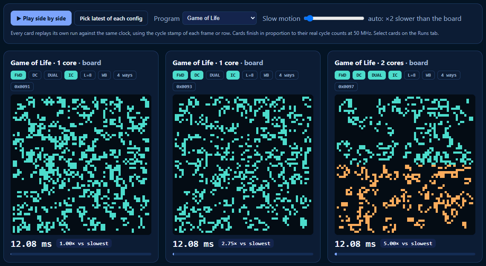
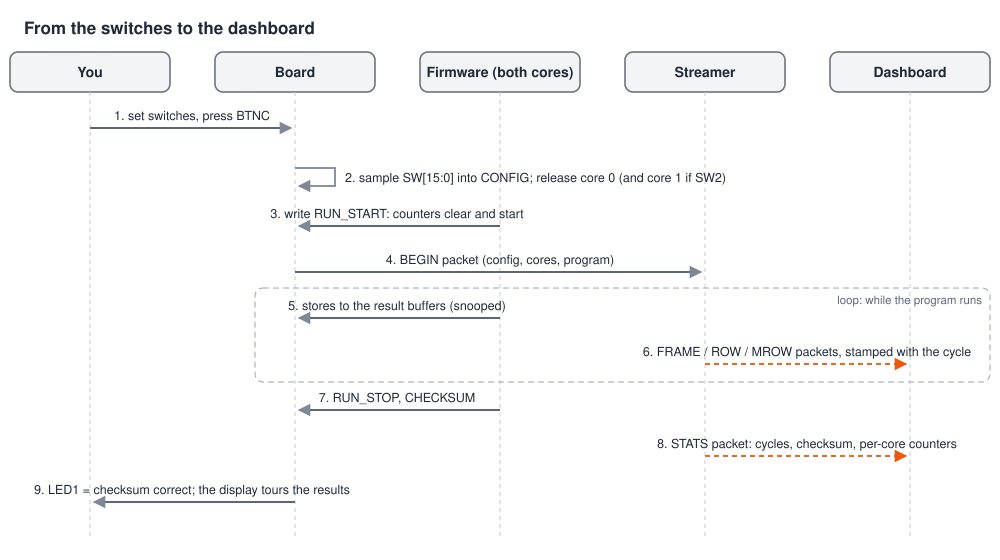
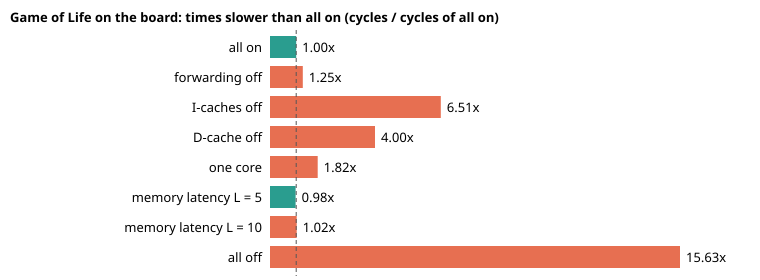
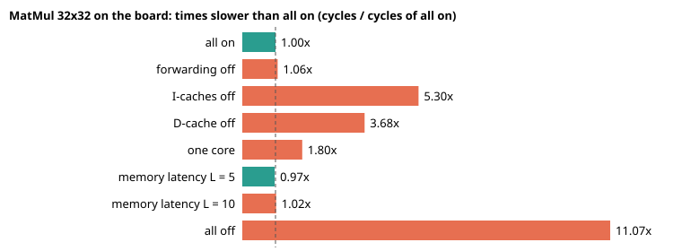
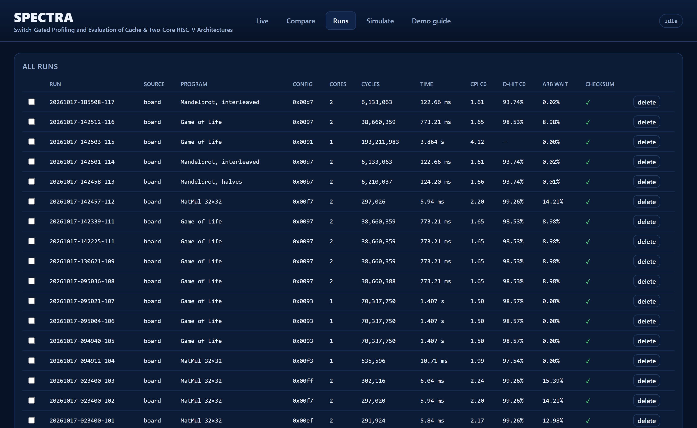
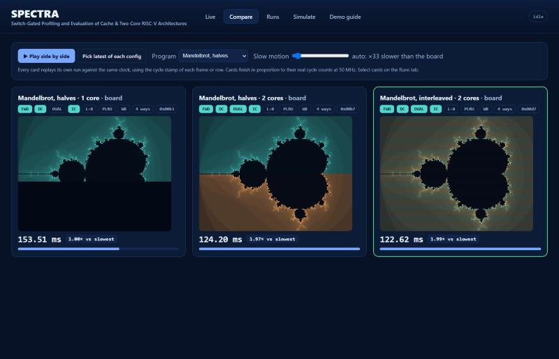

<div align="center">

# SPECTRA

### Switch-Gated Profiling and Evaluation of Cache & Two-Core RISC-V Architectures

A dual-core **RV32IM** processor on the **Nexys A7-100T** FPGA (Artix-7, 50 MHz), built to measure
parallel processing and multi-core efficiency. Board switches **turn the second core on or off**, and
four more hardware features can be toggled the same way: **operand forwarding**, **private instruction
caches**, a **shared 4-way data cache** and **memory latency**. Per-core **hardware performance
counters** measure execution time, waiting cycles and cache hits and misses. The same bitstream and
program binary run in every configuration, so a change in cycle count comes only from the feature that
was switched.

<br/>

[](rtl/)
[](https://riscv.org/)
[](https://digilent.com/reference/programmable-logic/nexys-a7/start)
[](https://www.amd.com/en/products/software/adaptive-socs-and-fpgas/vivado.html)

<br/>



<sub>Game of Life (64×64, 400 generations) replayed from three board runs on one clock: D-cache off · D-cache on · two cores — 3.86 s · 1.41 s · 0.77 s, same final grid and checksum. Core 1's rows in orange.</sub>

</div>

---

## Overview

**Motivation.** Textbooks say that a second core, caches and data forwarding make a processor faster,
but simple estimates rarely match real hardware: real programs meet bus contention, cache misses and
pipeline stalls.

**Objective.** Measure the real speed-up of each of these mechanisms on an FPGA, with the main focus on
running two cores in parallel.

**Method: one controlled test per switch.** Every optional feature, including the second core, has a
bypass path in hardware. When **BTNC** is pressed, the 16 slide switches are saved into a configuration
register that stays fixed for the whole run. The bitstream and the program never change, so the
difference in cycles between two runs is exactly the effect of the switched feature — measured in
seconds, with no re-synthesis.

### Features

- Two 3-stage RV32IM cores (IF/ID · EX · MEM/WB) with switchable MEM/WB → EX forwarding, a DSP-based
  multiplier (3 cycles) and an iterative divider (34 cycles)
- Private 2 KB 2-way instruction cache per core (FIFO replacement)
- Shared 4 KB 4-way data cache (write-back, PLRU replacement) behind a round-robin arbiter
- Hardware LOCK and BARRIER so the two cores can share data and wait for each other
- Memory latency model in front of the block RAMs: 5, 6, 8 or 10 cycles
- 15 hardware counters: cycles, and per core instructions, I- and D-cache hits and misses, arbiter and
  barrier wait
- Results streamed over UART (1 Mbaud) to a laptop dashboard; the 7-segment display shows the cycles,
  cache hit rates, CPI and arbiter wait in a loop

---

## Architecture

Three animated block diagrams, from the whole system down to one core and the shared data side. In each,
the blocks that one step uses light up, six steps in a loop. Grey = lab block unchanged, pale orange =
lab block modified, blue = new block.

### Part 1 · System

<p align="center">
  
</p>

### Part 2 · Core pipeline (both cores are the same RTL)

<p align="center">
  
</p>

### Part 3 · Data side

<p align="center">
  
</p>

### Life of a run

<p align="center">
  
</p>

- **Forwarding (SW0):** MEM/WB → EX for both source registers and store data. When off, every
  back-to-back dependent instruction costs one stall cycle.
- **Stalls:** a cache miss or a busy multiplier/divider holds the pipeline until it is ready.
- **Branches** are resolved in EX; a taken branch, JAL or JALR flushes the two younger instructions.

Timing rules for each part: [`docs/architecture.md`](docs/architecture.md).

---

## Measured results

All numbers are **measured on the board at 50 MHz** (default: forwarding and both caches on, L = 8).

### Two cores

| Program | Cycles, 1 core | Cycles, 2 cores | Time | Speed-up |
| --- | ---: | ---: | :---: | :---: |
| Game of Life (64×64, 400 generations) | 70,337,750 | 38,660,388 | 1.41 s → 0.77 s | **1.82×** |
| Mandelbrot, halves (192×144) | 12,224,498 | 6,209,751 | 244 → 124 ms | **1.97×** |
| Mandelbrot, interleaved rows | 12,224,409 | 6,131,187 | 244 → 123 ms | **1.99×** |
| MatMul (32×32) | 535,596 | 297,020 | 10.7 → 5.9 ms | **1.80×** |

Mandelbrot is compute-bound and scales almost perfectly. Game of Life and MatMul share the data cache,
so the two cores sometimes wait for each other at the arbiter (9 % and 14 % of the cycles).

### What each feature is worth

How much slower the two-core run becomes when one feature is switched off:

| Switched off | Game of Life | MatMul | Why |
| --- | :---: | :---: | --- |
| I-caches | **6.51×** | **5.30×** | every instruction fetch goes to slow memory |
| D-cache | **4.00×** | **3.68×** | every load and store goes to slow memory |
| Second core | 1.82× | 1.80× | |
| Forwarding | 1.25× | 1.06× | one stall cycle per dependent instruction |
| Memory latency 8 → 10 cycles | 1.02× | 1.02× | the caches hide almost all of it |
| **Everything** (1 core, no forwarding, no caches) | **15.63×** | **11.07×** | |

<p align="center">
  
  
</p>

### Resources

Post-route on xc7a100tcsg324-1, timing met at 50 MHz:

| Resource | Used | Available | Utilization |
| --- | ---: | ---: | ---: |
| LUT | 9,982 | 63,400 | 15.7 % |
| Flip-flops | 8,230 | 126,800 | 6.5 % |
| Block RAM tiles | 53 | 135 | 39.3 % |
| DSP48E1 | 8 | 240 | 3.3 % |

---

## Board reference

### Switches

Set the switches, then press **BTNC**: the setting is saved and the program runs.

| Switch | Meaning |
| --- | --- |
| SW0 | Forwarding on / off |
| SW1 | Shared D-cache on / off |
| SW2 | Second core on / off |
| SW4:3 | Memory latency: 00 = 5 · 01 = 6 · 10 = 8 · 11 = 10 cycles |
| SW6:5 | Program: 00 Game of Life · 01 Mandelbrot (halves) · 10 Mandelbrot (interleaved) · 11 MatMul |
| SW7 | I-caches on / off |
| SW13:8 | Not used |
| SW15:14 | Which counter the display shows after a run |

| Example | Switches |
| --- | --- |
| Game of Life, 2 cores, everything on | `0x0097` |
| Game of Life, 1 core, D-cache off | `0x0091` |
| Mandelbrot interleaved, 2 cores | `0x00D7` |
| MatMul, 2 cores | `0x00F7` |
| Everything off (1 core, no forwarding, no caches) | `0x0010` |

### Buttons, display and LEDs

| Control | Action |
| --- | --- |
| **BTNC** | Reset: save the switches and run |
| **BTNU** | Restart the display loop |
| **BTNL** | Display: count ↔ rate (hit %, CPI) |
| **BTNR** | Display: core 0 ↔ core 1 |

After a run the display shows each result for 3 s with a label, for example `Cy 38660` (cycles in
thousands), `IH0. 99.99` (I-cache hit %), `dH0. 98.53` (D-cache hit %), `CPI0. 1.64` and
`Ar0.  8.98` (arbiter wait %). **LED0** = run done, **LED1** = checksum correct.

---

## Repository structure

```text
.
├── rtl/
│   ├── core/            RV32IM core: pipeline, decoder, register file, hazard unit, MUL / DIV, I-cache
│   ├── mem/             shared D-cache, PLRU and FIFO replacement, latency model, instruction and data BRAMs
│   ├── soc/             clock and reset, switch config, arbiter, LOCK / BARRIER, counters, MMIO
│   ├── io/              UART, result streamer, 7-segment driver, JTAG VIO hook
│   ├── board/           Nexys A7 constraints
│   ├── lab5a/           the lab 5A pipeline the core was developed from
│   ├── soc_top.v        the SoC
│   └── top_fpga.v       the Nexys A7 top level
├── tb/                  one testbench per RTL module, plus the core and whole-SoC tests
├── sim/                 Vivado file lists, the test list, and rv32sim (instruction simulator)
├── fw/                  firmware in C: Game of Life, Mandelbrot, MatMul, test programs
├── host/                laptop dashboard
├── scripts/             build, program and test scripts
├── tools/               Python reference models used by the testbenches
├── docs/                PROTOCOL.md (memory map and registers), spec/ (one page per module), results/
└── build/releases/      pre-built bitstream (fpga-v1)
```

---

## RTL modules and their testbenches

Every RTL file has a self-checking testbench that prints `PASS` or `FAIL`.

| File | Purpose | Testbench |
| --- | --- | --- |
| `rtl/core/core.v` | One RV32IM core, 3 stages (IF/ID, EX, MEM/WB) | `tb_core` |
| `rtl/core/decoder.v` | Instruction decoder | `tb_decoder` |
| `rtl/core/regfile.v` | 32 × 32-bit register file | `tb_regfile` |
| `rtl/core/hazard_unit.v` | Forwarding, stall and flush decisions | `tb_hazard_unit` |
| `rtl/core/execute.v` | EX stage: ALU, branches, MUL / DIV control | `tb_execute` |
| `rtl/core/mul.v` · `mul_unit.v` | Multiplier on DSP48 slices · its port adapter | `tb_mul_unit` |
| `rtl/core/div.v` · `div_unit.v` | Iterative divider · its port adapter | `tb_div_unit` |
| `rtl/core/mem_stage.v` | Loads and stores: byte enables, alignment, sign extension | `tb_mem_stage` |
| `rtl/core/icache.v` | Private I-cache: 2 KB, 2-way | `tb_icache` |
| `rtl/core/commit_trace.v` | Simulation-only trace of every retired instruction | `tb_commit_trace` |
| `rtl/mem/dcache.v` | Shared D-cache: 4 KB, 4-way, write-back | `tb_dcache` |
| `rtl/mem/plru.v` · `fifo.v` | Pseudo-LRU (D-cache) · FIFO (I-cache) replacement | `tb_plru` · `tb_fifo` |
| `rtl/mem/mem_delay.v` | Memory latency model, 5 / 6 / 8 / 10 cycles | `tb_mem_delay` |
| `rtl/mem/imem_bram.v` · `dmem_bram.v` | 16 KB instruction memory · 128 KB data memory | `tb_imem_bram` · `tb_dmem_bram` |
| `rtl/soc/rr_arbiter.v` | Round-robin arbiter for the two cores' data ports | `tb_rr_arbiter` |
| `rtl/soc/lock_barrier.v` | Hardware LOCK and BARRIER | `tb_lock_barrier` |
| `rtl/soc/addr_decode.v` | Sends each data access to the D-cache or MMIO | `tb_addr_decode` |
| `rtl/soc/mmio_bus.v` | MMIO registers: config, counters, LEDs, display, timer, buttons | `tb_mmio_bus` |
| `rtl/soc/perf_counters.v` | Per-core performance counters | `tb_perf_counters` |
| `rtl/soc/switch_cfg.v` · `core_ctrl.v` · `clk_rst.v` | Switch config · core release · 50 MHz clock and reset | `tb_switch_cfg` · `tb_core_ctrl` · `tb_clk_rst` |
| `rtl/io/result_streamer.v` | Turns the program's result stores into UART packets | `tb_result_streamer` |
| `rtl/io/uart_top.v` | UART transmitter, 1 Mbaud, with a FIFO | `tb_uart_top` |
| `rtl/io/seg7_bcd.v` | 8-digit 7-segment driver with letters | `tb_seg7_bcd` |
| `rtl/io/vio_hook.v` | JTAG hook: scripts drive switches and buttons | `tb_vio_hook` |
| `rtl/soc_top.v` · `rtl/top_fpga.v` | The SoC · the Nexys A7 top level | `tb_top` |

Each module also has a one-page specification in [`docs/spec/`](docs/spec/).

---

## Verification

Correctness was checked at four levels, from single modules up to the board:

| Level | What is checked | Compared against |
| --- | --- | --- |
| **Module** | Each RTL file in its own testbench (directed and random inputs) | Python reference models in `tools/` |
| **Core** | One core runs the test programs; every retired instruction is traced | `rv32sim`, our instruction simulator |
| **SoC** | The whole SoC runs Game of Life, Mandelbrot and MatMul on 1 and 2 cores | the correct checksum, UART output and counters |
| **Board** | The demo programs in many switch settings on the Nexys A7 | the same checksums |

Run everything (Vivado's xsim simulator):

```bash
python scripts/check_all.py          # software checks + every testbench
python scripts/regress.py dcache     # one testbench by name
```

To watch a testbench in the Vivado simulator GUI, run it once with `regress.py`, then open its snapshot:
`cd build/<commit>/regress/<name>` and `xsim <testbench>_snap -gui`.

---

## Quick start

### On the board (pre-built bitstream)

```bash
vivado -mode batch -nojournal -nolog -notrace -source scripts/program.tcl -tclargs build/releases/fpga-v1/top_fpga.bit
pip install pyserial
python host/spectra_host.py --port COM8          # Linux / macOS: --port /dev/ttyUSB1
```

Set the switches (for example `0x0097`), press **BTNC**, and watch the run at <http://localhost:8000>.

### Without a board

```bash
python host/spectra_host.py          # dashboard at http://localhost:8000
```

The **Simulate** tab runs any switch setting on `rv32sim`. These runs are marked `sim`: the results are
exact, the cycle counts are only estimates. Only runs marked `board` are measurements.

### Build from source

```bash
python fw/build.py                   # firmware  -> fw/build/
python scripts/check_all.py          # all tests
python scripts/fpga_build.py         # synthesis, implementation -> build/<commit>/impl/top_fpga/
```

Tools: Python 3.9+, Vivado 2025.2 (part `xc7a100tcsg324-1`), a C compiler for `rv32sim`, and the xPack
`riscv-none-elf-gcc` to rebuild the firmware (built images are included).

---

## Dashboard

<table>
<tr>
<td width="50%"><br/><sub><b>Live</b> — a Mandelbrot run on two cores, as it arrives from the board</sub></td>
<td width="50%"><br/><sub><b>Compare</b> — MatMul on one and two cores, replayed on one clock</sub></td>
</tr>
<tr>
<td width="50%"><br/><sub><b>Runs</b> — every board run with cycles, CPI, hit rate and checksum</sub></td>
<td width="50%"><br/><sub><b>Simulate</b> — the 16 switches on screen</sub></td>
</tr>
<tr>
<td width="50%"><br/><sub><b>Demo guide</b> — every demo case with its switches</sub></td>
<td width="50%"><br/><sub><b>Compare</b> — Mandelbrot on one core, then two cores by halves and by interleaved rows</sub></td>
</tr>
</table>

---

## Limitations

- The data cache is shared, so the two cores need no coherence protocol — and the project cannot show
  its cost.
- Switches take effect at the next reset, not in the middle of a run (by design).
- The work split between the cores is fixed in the C code, not chosen by a scheduler.

## Acknowledgements

Built for **CS2202L (Hardware Lab), IIT Guwahati — Group 7**. The core grew out of the course's lab 5A
three-stage pipeline (`rtl/lab5a/`). Board: Digilent Nexys A7-100T. ISA: the RISC-V unprivileged
specification (RV32I and the M extension).
