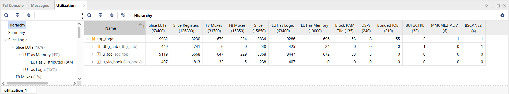
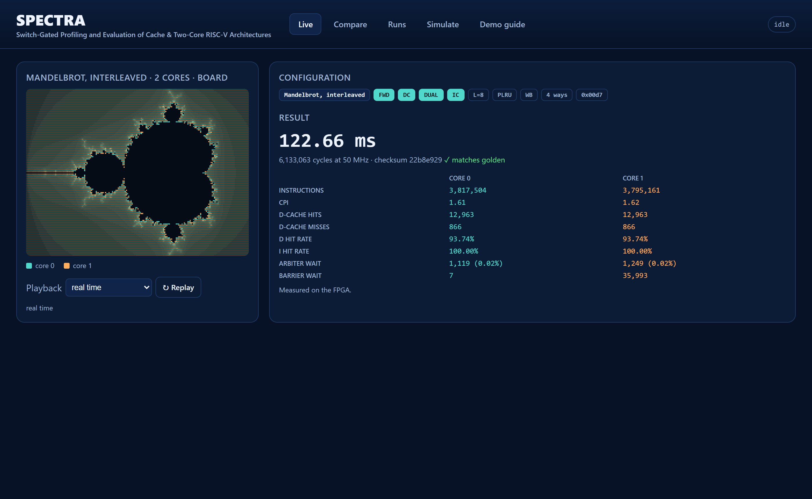
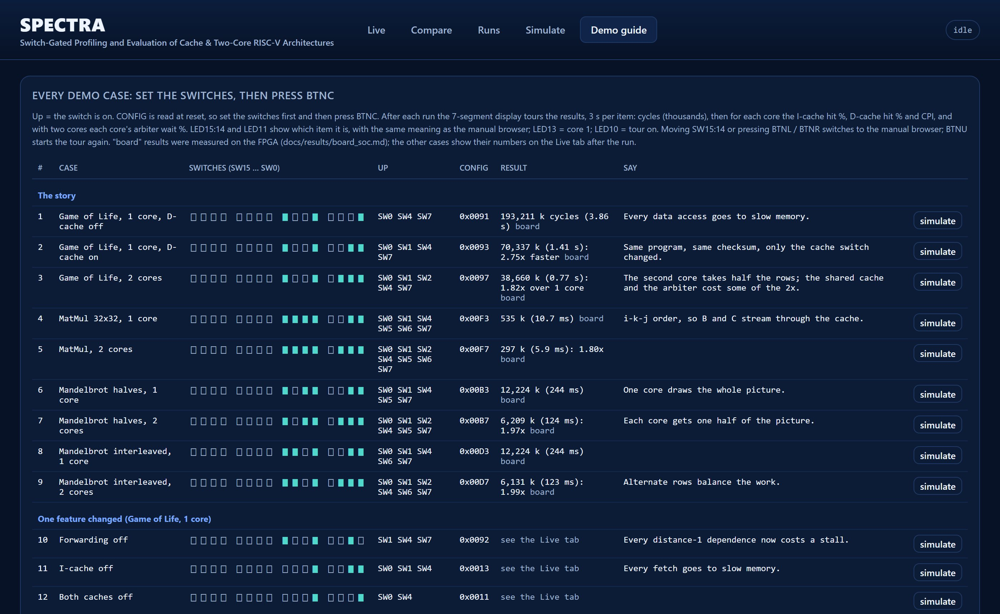

<div align="center">

# SPECTRA

### Switch-Gated Profiling and Evaluation of Cache & Two-Core RISC-V Architectures

A dual-core **RV32IM** processor on the **Nexys A7-100T** FPGA (Artix-7, 50 MHz), built to measure
parallel processing and multi-core efficiency. Board switches **turn the second core on or off**, and
four more hardware features can be toggled the same way: **operand forwarding**, **private instruction
caches**, a **shared 4-way data cache** and **memory latency**. Per-core **hardware performance
counters** measure execution time, waiting cycles and cache hits and misses. The same bitstream and
program binary run in every configuration, so a change in cycle count comes only from the feature that
was switched.

<br/>

[](rtl/)
[](https://riscv.org/)
[](https://digilent.com/reference/programmable-logic/nexys-a7/start)
[](https://www.amd.com/en/products/software/adaptive-socs-and-fpgas/vivado.html)
[](#resource-utilization)
[](#verification)
[](fw/)
[](host/)

[Overview](#overview) · [Architecture](#architecture) · [Results](#measured-results) · [Board reference](#board-reference) · [RTL & testbenches](#rtl-modules-and-their-testbenches) · [Software](#software) · [Verification](#verification) · [Quick start](#quick-start)

<br/>


<sub>Game of Life (64×64, 400 generations) replayed from three board runs on one clock: D-cache off · D-cache on · two cores — 3.86 s · 1.41 s · 0.77 s, same final grid and checksum. Core 1's rows in orange.</sub>

</div>

---

## Overview

**Motivation.** Textbooks say that a second core, caches and data forwarding make a processor faster,
but simple estimates rarely match real hardware: real programs meet bus contention, cache misses and
pipeline stalls.

**Objective.** Measure the real speed-up of each of these mechanisms on an FPGA, with the main focus on
running two cores in parallel.

**Method: one controlled test per switch.** Every optional feature, including the second core, has a
bypass path in hardware. When **BTNC** is pressed, the 16 slide switches are saved into a configuration
register that stays fixed for the whole run. The bitstream and the program never change, so the
difference in cycles between two runs is exactly the effect of the switched feature — measured in
seconds, with no re-synthesis.

### Features

- Two 3-stage RV32IM cores (IF/ID · EX · MEM/WB) with switchable MEM/WB → EX forwarding, a DSP-based
  multiplier (3 cycles) and an iterative divider (34 cycles)
- Private 2 KB 2-way instruction cache per core (FIFO replacement)
- Shared 4 KB 4-way data cache (write-back, PLRU replacement) behind a round-robin arbiter
- Hardware LOCK and BARRIER so the two cores can share data and wait for each other
- Memory latency model in front of the block RAMs: 5, 6, 8 or 10 cycles
- 15 hardware counters: cycles, and per core instructions, I- and D-cache hits and misses, arbiter and
  barrier wait
- Results streamed over UART (1 Mbaud) to a laptop dashboard; the 7-segment display shows the cycles,
  cache hit rates, CPI and arbiter wait in a loop

---

## Architecture

Three animated block diagrams, from the whole system down to one core and the shared data side. In each,
the blocks that one step uses light up, six steps in a loop. Pale orange = lab block modified, blue = new
block, grey = lab block unchanged (Part 2) or outside the FPGA (board, laptop).

### Part 1 · System

<p align="center">
  
</p>

### Part 2 · Core pipeline (both cores are the same RTL)

<p align="center">
  
</p>

### Part 3 · Data side

<p align="center">
  
</p>

### Life of a run

<p align="center">
  
</p>

- **Forwarding (SW0):** MEM/WB → EX for both source registers and store data. When off, every
  back-to-back dependent instruction costs one stall cycle.
- **Stalls:** a cache miss or a busy multiplier/divider holds the pipeline until it is ready.
- **Branches** are resolved in EX; a taken branch, JAL or JALR flushes the two younger instructions.

Timing rules for each part: [`docs/architecture.md`](docs/architecture.md).

---

## Measured results

All numbers are **measured on the board at 50 MHz** with the release bitstream `fpga-v2` (default:
forwarding and both caches on, L = 8). Source: [`docs/results/numbers.md`](docs/results/numbers.md).

### Two cores

| Program | Cycles, 1 core | Cycles, 2 cores | Time | Speed-up |
| --- | ---: | ---: | :---: | :---: |
| Game of Life (64×64, 400 generations) | 70,337,750 | 38,660,388 | 1.41 s → 0.77 s | **1.82×** |
| Mandelbrot, halves (192×144) | 12,224,498 | 6,209,751 | 244 → 124 ms | **1.97×** |
| Mandelbrot, interleaved rows | 12,224,409 | 6,131,187 | 244 → 123 ms | **1.99×** |
| MatMul (32×32) | 535,596 | 297,020 | 10.7 → 5.9 ms | **1.80×** |

Mandelbrot is compute-bound and scales almost perfectly. Game of Life and MatMul share the data cache,
so the two cores sometimes wait for each other at the arbiter (9 % and 14 % of the cycles).
The dashboard screenshots below are from earlier board runs, so a few two-core counts in them
differ slightly (under 0.1 %) from this table.

### What each feature is worth

How much slower the two-core run becomes when one feature is switched off:

| Switched off | Game of Life | MatMul | Why |
| --- | :---: | :---: | --- |
| I-caches | **6.51×** | **5.30×** | every instruction fetch goes to slow memory |
| D-cache | **4.00×** | **3.68×** | every load and store goes to slow memory |
| Second core | 1.82× | 1.80× | |
| Forwarding | 1.25× | 1.06× | one stall cycle per dependent instruction ([MatMul's loop](docs/results/matmul_loop.md)) |
| Memory latency 8 → 10 cycles | 1.02× | 1.02× | the caches hide almost all of it |
| **Everything** (1 core, no forwarding, no caches) | **15.63×** | **11.07×** | |

<p align="center">
  
  
</p>

### Resource utilization

Post-route utilization of the release bitstream `fpga-v2` on the `xc7a100tcsg324-1`, as reported by
Vivado. To see the same, open [`build/releases/fpga-v2/post_route.dcp`](build/releases/fpga-v2/) in
Vivado and run `report_utilization`:

<p align="center">
  
</p>

`top_fpga` is the whole design; `u_soc` is the two cores, caches and peripherals; `dbg_hub` and
`u_vio_hook` are the JTAG hook that lets scripts drive the switches and buttons.
Timing met at 50 MHz: WNS +0.262 ns, WHS +0.041 ns
([`timing_summary.rpt`](build/releases/fpga-v2/reports/timing_summary.rpt)). What each feature costs:
[`docs/results/area.md`](docs/results/area.md); each module alone: [`docs/results/synth_modules.md`](docs/results/synth_modules.md).

---

## Board reference

### Switches

Set the switches, then press **BTNC**: the setting is saved and the program runs.

| Switch | Meaning |
| --- | --- |
| SW0 | Forwarding on / off |
| SW1 | Shared D-cache on / off |
| SW2 | Second core on / off |
| SW4:3 | Memory latency: 00 = 5 · 01 = 6 · 10 = 8 · 11 = 10 cycles |
| SW6:5 | Program: 00 Game of Life · 01 Mandelbrot (halves) · 10 Mandelbrot (interleaved) · 11 MatMul |
| SW7 | I-caches on / off |
| SW13:8 | Not used |
| SW15:14 | Which counter the display shows after a run |

| Example | Switches |
| --- | --- |
| Game of Life, 2 cores, everything on | `0x0097` |
| Game of Life, 1 core, D-cache off | `0x0091` |
| Mandelbrot interleaved, 2 cores | `0x00D7` |
| MatMul, 2 cores | `0x00F7` |
| Everything off (1 core, no forwarding, no caches) | `0x0010` |

### Buttons, display and LEDs

| Control | Action |
| --- | --- |
| **BTNC** | Reset: save the switches and run |
| **BTNU** | Restart the display loop |
| **BTNL** | Display: count ↔ rate (hit %, CPI) |
| **BTNR** | Display: core 0 ↔ core 1 |

After a run the display shows each result for 3 s with a label, in a loop. MatMul on two cores
(`0x00F7`) on the board: `Cy   297` (cycles in thousands) → `IH0. 99.99` (core 0 I-cache hit %) →
`dH0. 99.25` (D-cache hit %) → `CPI0. 2.20` → the same for core 1 → `Ar0. 14.20` and `Ar1.  7.05`
(arbiter wait %). Rates are cut, not rounded, to two decimals. **LED0** = run done, **LED1** = checksum
correct.

---

## Repository structure

```text
.
├── rtl/
│   ├── core/            RV32IM core: pipeline, decoder, register file, hazard unit, MUL / DIV, I-cache
│   ├── mem/             shared D-cache, PLRU and FIFO replacement, latency model, instruction and data BRAMs
│   ├── soc/             clock and reset, switch config, arbiter, LOCK / BARRIER, counters, MMIO
│   ├── io/              UART, result streamer, 7-segment driver, JTAG VIO hook
│   ├── board/           Nexys A7 pin constraints, a stand-in driver for the bring-up build
│   ├── lab5a/           the lab 5A pipeline the core was developed from
│   ├── soc_top.v        the SoC
│   └── top_fpga.v       the Nexys A7 top level
├── tb/                  one testbench per RTL module, plus the core and whole-SoC tests
├── sim/                 Vivado file lists, the test list, and rv32sim (instruction simulator)
├── fw/                  firmware in C: Game of Life, Mandelbrot, MatMul, test programs
├── host/                laptop dashboard
├── scripts/             build, program and test scripts
├── tests/               run_all.py: the software checks (simulator, firmware, dashboard)
├── tools/               Python reference models used by the testbenches
├── modules/, sw/, constraints/   a separate first implementation of the SoC pieces, not used by the build
├── docs/                PROTOCOL.md (memory map and registers), spec/ (one page per module), results/
└── build/releases/      release fpga-v2: bitstream, routed design, reports, board results
```

---

## RTL modules and their testbenches

Every RTL file has a self-checking testbench that prints `PASS` or `FAIL`.

| File | Purpose | Testbench |
| --- | --- | --- |
| `rtl/core/core.v` | One RV32IM core, 3 stages (IF/ID, EX, MEM/WB) | `tb_core` |
| `rtl/core/decoder.v` | Instruction decoder | `tb_decoder` |
| `rtl/core/regfile.v` | 32 × 32-bit register file | `tb_regfile` |
| `rtl/core/hazard_unit.v` | Forwarding, stall and flush decisions | `tb_hazard_unit` |
| `rtl/core/execute.v` | EX stage: ALU, branches, MUL / DIV control | `tb_execute` |
| `rtl/core/mul.v` · `mul_unit.v` | Multiplier on DSP48 slices · its port adapter | `tb_mul_unit` |
| `rtl/core/div.v` · `div_unit.v` | Iterative divider · its port adapter | `tb_div_unit` |
| `rtl/core/mem_stage.v` | Loads and stores: byte enables, alignment, sign extension | `tb_mem_stage` |
| `rtl/core/icache.v` | Private I-cache: 2 KB, 2-way | `tb_icache` |
| `rtl/core/commit_trace.v` | Simulation-only trace of every retired instruction | `tb_commit_trace` |
| `rtl/mem/dcache.v` | Shared D-cache: 4 KB, 4-way, write-back | `tb_dcache` |
| `rtl/mem/plru.v` · `fifo.v` | Pseudo-LRU (D-cache) · FIFO (I-cache) replacement | `tb_plru` · `tb_fifo` |
| `rtl/mem/mem_delay.v` | Memory latency model, 5 / 6 / 8 / 10 cycles | `tb_mem_delay` |
| `rtl/mem/imem_bram.v` · `dmem_bram.v` | 16 KB instruction memory · 128 KB data memory | `tb_imem_bram` · `tb_dmem_bram` |
| `rtl/soc/rr_arbiter.v` | Round-robin arbiter for the two cores' data ports | `tb_rr_arbiter` |
| `rtl/soc/lock_barrier.v` | Hardware LOCK and BARRIER | `tb_lock_barrier` |
| `rtl/soc/addr_decode.v` | Sends each data access to the D-cache or MMIO | `tb_addr_decode` |
| `rtl/soc/mmio_bus.v` | MMIO registers: config, counters, LEDs, display, timer, buttons | `tb_mmio_bus` |
| `rtl/soc/perf_counters.v` | Per-core performance counters | `tb_perf_counters` |
| `rtl/soc/switch_cfg.v` · `core_ctrl.v` · `clk_rst.v` | Switch config · core release · 50 MHz clock and reset | `tb_switch_cfg` · `tb_core_ctrl` · `tb_clk_rst` |
| `rtl/io/result_streamer.v` | Turns the program's result stores into UART packets | `tb_result_streamer` |
| `rtl/io/uart_top.v` | UART transmitter, 1 Mbaud, with a FIFO | `tb_uart_top` |
| `rtl/io/seg7_bcd.v` | 8-digit 7-segment driver with letters | `tb_seg7_bcd` |
| `rtl/io/vio_hook.v` | JTAG hook: scripts drive switches and buttons | `tb_vio_hook` |
| `rtl/soc_top.v` · `rtl/top_fpga.v` | The SoC · the Nexys A7 top level | `tb_top` |
| `rtl/board/shell_driver.v` | Stands in for the cores in the early board bring-up build (no cores) | (board check only) |

Each module also has a one-page specification in [`docs/spec/`](docs/spec/).

---

## Software

| File | What it does |
| --- | --- |
| **Firmware** (`fw/`, C for the cores) | |
| `boot.S`, `link.ld` | Start-up code for both cores (one stack each) and the memory map |
| `main.c` | Reads the switch setting and runs the selected program on every running core |
| `gol.c` · `mandel.c` · `matmul.c` | Game of Life · Mandelbrot · matrix multiply, rows split between the two cores |
| `display.c` | After the run: the 7-segment tour of counters and the counter browser |
| `util.c`, `spectra.h` | Shared helpers, register addresses, LOCK and BARRIER calls |
| `tests/t_*.c` | Small test programs: hazards, M extension, caches, LOCK, BARRIER |
| `build.py` | Compiles every program with RISC-V GCC into `imem.hex` / `dmem.hex` |
| **Laptop** (`host/`, Python) | |
| `spectra_host.py` | Reads the board's UART, saves every run and serves the dashboard |
| `dashboard.html` | The dashboard: Live, Compare, Runs, Simulate and Demo guide tabs |
| `protocol.py` | Decodes the UART packets (BEGIN, ROW, STATS, ...) and checks their CRC |
| `uart_packets.py` | Captures the UART for a few seconds and lists the packets, for debugging |
| **Reference models** (`tools/`, `sim/`) | |
| `sim/rv32sim.c` | Instruction simulator of the whole SoC (two harts, caches, counters); gives the expected trace and UART output |
| `golden.py` | Python versions of every program: the correct checksum for each |
| `mext_ref.py` · `cache_model.py` · `arbiter_ref.py` · `seg7_model.py` | Reference models for MUL/DIV, the caches, the arbiter and the display |
| `gen_*_vectors.py` | Write the test vectors (`tb/vectors/`) the module testbenches compare against |
| `make_refs.py` · `tracecmp.py` | Make the reference traces from rv32sim · compare an RTL trace with it |
| `check_maps.py` | Checks that `docs/PROTOCOL.md` and `fw/spectra.h` give the same addresses |
| **Scripts** (`scripts/`) | |
| `check_all.py` | Runs every software check and every testbench |
| `tests/run_all.py` | The 11 groups of software checks: reference models, firmware, rv32sim, golden checksums, cache model, packets, display, trace compare, fault injection, dashboard host |
| `regress.py`, `sim.tcl` | Run the testbenches in `sim/tests.txt` in xsim |
| `fpga_build.py`, `build.tcl` | Synthesis, implementation and bitstream, then checks timing and resources |
| `program.tcl` · `program_flash.tcl` | Load the bitstream over JTAG · write it to the board's flash |
| `updatemem.py` | Puts a new program into a built bitstream without running synthesis again |
| `board_regress.py`, `board.tcl` | Run a list of switch settings on the board and check every run |
| `board_browser.py` · `board_soak.py` | Check the 7-segment display on the board · rerun after random resets |
| `synth_ooc.tcl` | Synthesise and route one module alone, for its resources and timing |
| `ablation.py` · `area.py` · `numbers.py` | Feature speed-ups · feature costs in LUTs · every headline number with its source |
| `build_bitstream.tcl`, `ablation_sweep.tcl`, `dashboard.py`, `uart_monitor.py` | Build, sweep, dashboard and serial monitor of the separate design in `modules/` and `sw/` |

---

## Verification

Correctness was checked at four levels, from single modules up to the board:

| Level | What is checked | Compared against |
| --- | --- | --- |
| **Module** | Each RTL file in its own testbench | expected values in the testbench, or test vectors from the Python models in `tools/` |
| **Core** | One core runs the test programs; every retired instruction is traced | `rv32sim`, our instruction simulator |
| **SoC** | The whole SoC runs MatMul on 1 and 2 cores; its run cycles equal the board's (535,596 and 297,020) | the correct checksum, every UART packet and the counters |
| **Board** | 239 runs (demo, latency, ablation, 120 random settings, test programs), 108 display readings, 40 runs after random resets ([`docs/results/board_regress.md`](docs/results/board_regress.md)) | rv32sim: the checksum and every UART packet |

Which RTL path each check in the test programs exercises: [`docs/spec/test_map.md`](docs/spec/test_map.md).

### Running the testbenches

Needs Vivado (its xsim simulator) and Python. Every test is one line in
[`sim/tests.txt`](sim/tests.txt): the test name, its file list and the testbench.

```bash
python scripts/check_all.py                 # everything: software checks + all 35 tests
python scripts/regress.py                   # all 35 RTL tests, with a PASS/FAIL table
python scripts/regress.py <name> [<name>]   # chosen tests, for example: dcache icache core_matmul
```

Any testbench can also be run straight through Vivado, using its file list from `sim/`:

```bash
vivado -mode batch -nojournal -nolog -source scripts/sim.tcl -tclargs -f sim/<module>.f -top tb_<module>
```

(add `-hex <dir>` when the line in `sim/tests.txt` lists one, for example `-hex tb/vectors`).

Each run prints `SIM PASS <testbench>` or `SIM FAIL <testbench>: <reason>`. Its logs stay in its run
directory: `build/<commit>/regress/<name>/` (regress.py) or `build/<commit>/sim/tb_<module>/` (direct).
To see the waveforms, open that run in the simulator GUI: `cd` into the run directory, then
`xsim tb_<module>_snap -gui`.

---

## Quick start

```bash
git clone https://github.com/DivyamCS/SPECTRA_hardware_lab.git
cd SPECTRA_hardware_lab
```

What each part needs (on macOS write `python3` for `python`):

| To | Windows / Linux | macOS |
| --- | --- | --- |
| Use the dashboard and simulate, no board | Python 3.9+, a C compiler for rv32sim (gcc, or `pip install ziglang==0.13.0`) | Python 3.9+, the Xcode command-line tools (`xcode-select --install`) |
| Program the board, see live runs | Vivado 2025.2 or Vivado Lab Edition, `pip install pyserial` | Vivado does not run on macOS; a board that boots from its flash still streams to the dashboard (`pip install pyserial`) |
| Run the tests, rebuild | Vivado 2025.2, and xPack `riscv-none-elf-gcc` or `pip install ziglang==0.13.0` for the firmware | not possible (no Vivado) |

Vivado's commands need its environment first: `C:\AMDDesignTools\2025.2\Vivado\settings64.bat` (Windows) or
`source <install>/Vivado/settings64.sh` (Linux), or add Vivado's `bin` folder to `PATH`.

### On the board (pre-built bitstream)

```bash
vivado -mode batch -nojournal -nolog -notrace -source scripts/program.tcl -tclargs build/releases/fpga-v2/top_fpga.bit
pip install pyserial
python host/spectra_host.py --port COM8
```

`--port` is the board's USB serial port: Windows Device Manager -> Ports ("USB Serial Port (COMx)");
Linux `ls /dev/ttyUSB*` (usually `/dev/ttyUSB1`); macOS `ls /dev/tty.usbserial*`. Set the switches (for
example `0x0097`), press **BTNC**, and watch the run at <http://localhost:8000>.

To start the board without a laptop: write the design into its flash once
(`vivado -mode batch -source scripts/program_flash.tcl -tclargs build/releases/fpga-v2/flash/top_fpga.mcs --yes-program-the-flash`)
and set jumper JP1 to QSPI. At power-on it runs once with the switches as they are; every BTNC then
starts a new run.

### Without a board

```bash
python host/spectra_host.py          # dashboard at http://localhost:8000
```

The **Simulate** tab runs any switch setting on `rv32sim`. These runs are marked `sim`: the results are
exact, the cycle counts are only estimates. Only runs marked `board` are measurements.

### Build from source

```bash
python fw/build.py                   # firmware  -> fw/build/
python scripts/check_all.py          # all tests (builds the firmware into a temporary folder, changes no file)
python scripts/fpga_build.py         # synthesis, implementation -> build/<commit>/impl/top_fpga/
```

`fpga_build.py` checks the resources against `scripts/fpga_budget.txt` (the release build), so use
Vivado 2025.2. A rebuild of the release RTL gives the same configuration data as
`build/releases/fpga-v2/top_fpga.bit`; only the build time in the file header differs.

---

## Dashboard

<table>
<tr>
<td width="50%"><br/><sub><b>Live</b> — a Mandelbrot run on two cores, as it arrives from the board</sub></td>
<td width="50%"><br/><sub><b>Compare</b> — MatMul on one and two cores, replayed on one clock</sub></td>
</tr>
<tr>
<td width="50%"><br/><sub><b>Runs</b> — every board run with cycles, CPI, hit rate and checksum</sub></td>
<td width="50%"><br/><sub><b>Simulate</b> — the 16 switches on screen</sub></td>
</tr>
<tr>
<td width="50%"><br/><sub><b>Demo guide</b> — every demo case with its switches</sub></td>
<td width="50%"><br/><sub><b>Compare</b> — Mandelbrot on one core, then two cores by halves and by interleaved rows</sub></td>
</tr>
</table>

---

## Limitations

- The data cache is shared, so the two cores need no coherence protocol — and the project cannot show
  its cost.
- Switches take effect at the next reset, not in the middle of a run (by design).
- The work split between the cores is fixed in the C code, not chosen by a scheduler.

## Acknowledgements

Built for **CS2202L (Hardware Lab), IIT Guwahati — Group 7**. The core grew out of the course's lab 5A
three-stage pipeline (`rtl/lab5a/`). Board: Digilent Nexys A7-100T. ISA: the RISC-V unprivileged
specification (RV32I and the M extension).
