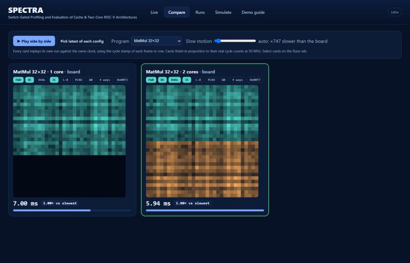
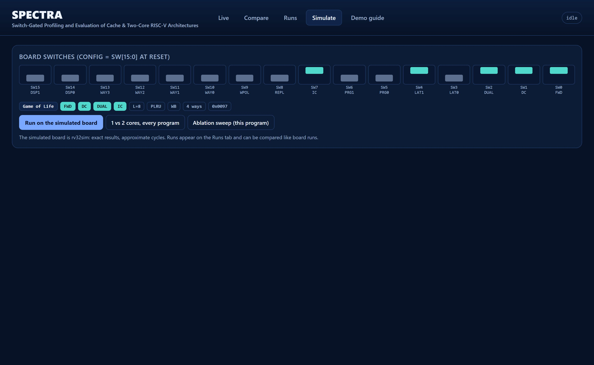

<div align="center">

# SPECTRA

### Switch-Gated Profiling and Evaluation of Cache & Two-Core RISC-V Architectures

A dual-core **RV32IM** processor on the **Nexys A7-100T** FPGA (Artix-7, 50 MHz), built to measure
parallel processing and multi-core efficiency. The board's switches **enable or disable the second
core**, so shared-memory behaviour and system throughput can be observed directly. Four more hardware
features can also be toggled: **data forwarding**, **private instruction caches**, a **shared 4-way
data cache** and **added memory latency**. Dedicated **per-core performance counters** record
execution time, wait (idle) cycles and memory traffic. The same program binary and bitstream run in
the single-core and dual-core setups, so any performance gain comes directly from running two cores
in parallel.

<br/>

[](rtl/)
[](https://riscv.org/)
[](https://digilent.com/reference/programmable-logic/nexys-a7/start)
[](https://www.amd.com/en/products/software/adaptive-socs-and-fpgas/vivado.html)
[](#resource-utilization)
[](#verification)
[](host/)

[Overview](#overview) · [Architecture](#architecture) · [Results](#measured-results) · [Quick start](#quick-start) · [Board reference](#board-reference) · [Verification](#verification) · [Project structure](#project-structure)

<br/>


<sub>Game of Life (64×64, 400 generations) replayed from three board runs on one clock, 2× slow motion: D-cache off · D-cache on · two cores — 3.86 s · 1.41 s · 0.77 s, identical final grid and checksum. Core 1's rows in orange.</sub>

</div>

---

## Overview

**Motivation.** Textbooks say that a second core, caches and data forwarding make a processor
faster, but simple estimates rarely match real hardware. Real workloads meet bus contention, cache
misses and pipeline stalls that these models leave out.

**Objective.** Measure the true speed-up and trade-offs of these mechanisms on real FPGA hardware,
with the main focus on parallel dual-core execution across different benchmark workloads.

**The problem solved.** Testing an architectural trade-off normally means slow software simulation,
or re-running synthesis and implementation for every feature change. SPECTRA builds run-time
hardware bypasses into the design instead. Any feature is toggled with an on-board switch while the
bitstream and the program binary stay identical, so there is no rebuild, and the effect of each
mechanism is isolated in seconds.

**The method: one controlled test per switch.** Every optional feature, including the second core,
has its own bypass path. At reset (**BTNC**) the 16 slide switches are saved into a configuration
register that stays fixed for the whole run, so each run is one well-defined hardware configuration.
Because the bitstream and the program binary never change, the difference in execution time between
two runs is exactly the effect of the feature that was switched.

| Switched mechanism | Range | Switches |
| --- | --- | --- |
| Operand forwarding MEM/WB → EX | on / off (off: 1-cycle interlock per dependence) | SW0 |
| Shared D-cache, 4 KB, 4-way, write-back, PLRU | on / off | SW1 |
| Private I-caches, 2 KB, 2-way, FIFO | on / off | SW7 |
| Second core (shared D-cache, round-robin arbiter, hardware barrier) | 1 or 2 cores | SW2 |
| Memory latency in front of the BRAMs | L = 5, 6, 8, 10 cycles | SW4:3 |
| Workload | Game of Life · Mandelbrot (two work splits) · MatMul 32×32 | SW6:5 |

**The measurement.** Firmware writes RUN_START and RUN_STOP around the measured kernel; in between,
15 hardware counters run: cycles (execution time), and per core instructions retired, I- and D-cache
hits and misses (memory traffic), arbiter wait and barrier wait (idle cycles). They leave the board in a CRC-checked UART packet together
with the program's checksum, appear on the labelled 7-segment display, and feed the dashboard,
which derives CPI, hit rates and speed-ups. A result streamer snoops the program's own stores, so
the dashboard draws each frame, row and matrix as the cores compute it, without a single print
instruction in the measured code.

```text
SW = 0x0091   Game of Life, 1 core, D-cache off     193,212,013 cycles   3.86 s
SW = 0x0093   Game of Life, 1 core, D-cache on       70,337,750 cycles   1.41 s   2.75× faster
SW = 0x0097   Game of Life, 2 cores                  38,660,388 cycles   0.77 s   1.82× faster again
SW = 0x0010   Game of Life, every feature off       604,166,137 cycles  12.08 s   15.6× slower than all on
```

**The evidence.** Every claim is checked at four levels ([details](#verification)):

| Level | Simulation or test | Compared against |
| --- | --- | --- |
| Module | 33 self-checking Vivado **xsim** testbenches, directed and random vectors | Python reference models (`tools/cache_model.py`, arbiter, MUL / DIV, decoder) |
| Core | xsim **commit trace**: PC, instruction, register write and memory access of every retired instruction | the `rv32sim` instruction-set simulator, 0 differences |
| System | whole-SoC xsim runs of every program | golden checksums (`tools/golden.py`), every UART packet and every counter of `rv32sim` |
| Board | 263 scripted runs through a JTAG VIO hook | the same packets and checksums; cycles = the RTL simulation's |

| At a glance | |
| --- | --- |
| **Cores** | 2 × RV32IM, 3-stage pipeline (IF/ID · EX · MEM/WB), switchable forwarding, MUL on DSP48, iterative DIV, hardware LOCK and BARRIER |
| **Memory system** | Private 2 KB 2-way I-caches (FIFO) · shared 4 KB 4-way D-cache (write-back, PLRU) · memory latency model 5–10 cycles · 16 KB IMEM, 128 KB DMEM |
| **Configuration** | 7 fields on 16 switches, sampled at reset — no re-synthesis, no reprogramming |
| **Measurement** | 15 hardware counters (cycles; per core: instructions, I / D hits and misses, arbiter and barrier wait) |
| **Workloads** | Game of Life 64×64 · Mandelbrot 192×144, split by halves or by interleaved rows · MatMul 32×32 · 5 test programs |
| **Output** | Result streamer, UART 1 Mbaud, CRC-checked packets · labelled 7-segment display · live web dashboard |
| **Resources** | 10,329 LUT (16 %) · 53 BRAM (40 %) · 8 DSP · 50 MHz, timing met |

---

## What SPECTRA demonstrates

| Goal | How SPECTRA does it | Verified by |
| --- | --- | --- |
| Turn any feature on or off **without rebuilding** | Switches are sampled into a configuration word at reset; each feature has a bypass path in hardware | Every program × configuration golden on the board (263 runs) |
| Measure, don't estimate | Per-core hardware counters, read out over UART in a CRC-checked STATS packet | Counters equal the instruction simulator and the Python cache model exactly (`tb/top/check_counters.py`) |
| Show the **two-core** speed-up | Second core released by SW2; shared D-cache behind a round-robin arbiter; hardware barrier | 1.80×–1.99× on the board across all three programs |
| Show the **cache** effect | I-caches, D-cache and memory latency all switchable | Up to 6.5× from the I-caches and 4.0× from the D-cache |
| Stay **correct** in every configuration | Same binary, same checksum, every switch setting | 120 seeded random settings on the board, 0 failures |
| Make it **visible** | Streamer snoops the program's result buffers; the dashboard redraws them live | Every UART packet equals the reference simulator's |
| Be **reproducible** | Deterministic hardware and firmware; scripted board runs through a JTAG hook | Same configuration → identical cycle count and packet stream, run after run |

---

## Architecture

Three animated block diagrams, from the whole system down to one core and the shared data side.
In each, the blocks and wires that one step uses light up in orange, six steps in a loop; the
caption under the drawing names the step. Grey = lab block unchanged, orange = lab block
modified, blue = new block, amber dashed = link to another part.

### Part 1 · System

<p align="center">
  
</p>

### Part 2 · Core 0 pipeline (core 1 is the same RTL)

<p align="center">
  
</p>

### Part 3 · Data side

<p align="center">
  
</p>

**[Timing rules and notes for each part →](docs/architecture.md)**

| Design decision | Reason |
| --- | --- |
| **Switches sampled once, at reset** | A run is always one consistent configuration; changing a switch mid-run can never corrupt it. BTNC is the "apply" button. |
| **Every feature has a hardware bypass** | The same bitstream and the same program binary run in all configurations, so a speed-up can only come from the feature itself. |
| **Counters in hardware, gated by RUN_START / RUN_STOP** | The measurement includes nothing but the program, costs the program nothing, and needs no timer arithmetic in software. |
| **One shared D-cache instead of two private ones** | Two cores need no coherence protocol, yet still contend for it — the arbiter wait counter shows the price of sharing. |
| **Latency model in front of the BRAMs** | On-chip BRAM answers in one cycle; a configurable 5–10-cycle latency makes the caches matter as they would with real DRAM. |
| **Results streamed by snooping, not by printing** | The firmware never formats or sends a byte: the streamer copies stores to the result buffers, so streaming does not disturb the measured run. |
| **JTAG VIO hook** | Scripts set switches, press buttons and read the display, so hundreds of board runs execute unattended and are checked automatically. |

### Core pipeline in brief

- **Forwarding (SW0):** MEM/WB → EX for rs1, rs2 and store data. Off, every distance-1 dependence costs a one-cycle interlock.
- **Global freeze:** an I-cache or D-cache miss, or a busy MUL / DIV, freezes the pipeline; a bubble enters MEM/WB while EX holds.
- **Branches** resolve in EX; a taken branch, JAL or JALR squashes the two younger instructions.
- **M extension:** `MUL`, `MULH`, `MULHSU`, `MULHU` on DSP48 slices; `DIV`, `DIVU`, `REM`, `REMU` iterative, with the spec's results for division by zero and overflow.

### Life of a run

<p align="center">
  
</p>

---

## Measured results

All numbers are **board measurements at 50 MHz** (release `fpga-v1`; source rows in [`docs/results/numbers.md`](docs/results/numbers.md)).
Default configuration: forwarding, both caches (I-cache FIFO, D-cache PLRU), write-back, 4 ways, L = 8.
fpga-v1's I-cache used 1-bit LRU; the current RTL (FIFO) was rebuilt and rerun on the board: all 115 runs
identical to fpga-v1 ([`docs/results/board_icache_fifo.md`](docs/results/board_icache_fifo.md)).
The team's integrated RTL (25 Oct: the members' modules, a write-back-only D-cache) passes every
RTL test, including the cycle-exact ones, and builds with timing met; it has not been re-run on the board yet.

### Two cores

| Program | Cycles, 1 core | Cycles, 2 cores | Time | Speed-up |
| --- | ---: | ---: | :---: | :---: |
| Game of Life (64×64, 400 generations) | 70,337,750 | 38,660,388 | 1.41 s → 0.77 s | **1.82×** |
| Mandelbrot, halves (192×144) | 12,224,498 | 6,209,751 | 244 → 124 ms | **1.97×** |
| Mandelbrot, interleaved rows | 12,224,409 | 6,131,187 | 244 → 123 ms | **1.99×** |
| MatMul (32×32) | 535,596 | 297,020 | 10.7 → 5.9 ms | **1.80×** |

Mandelbrot is compute-bound (CPI 1.6, arbiter wait 0.02 %) and scales almost perfectly. Game of Life
and MatMul share the D-cache and the arbiter and lose part of the 2× to waiting for each other
(arbiter wait 9 % and 14 %).

### What each feature is worth

How much slower the two-core run becomes when one feature is switched off (board ablation sweep for
the two memory-heavy programs; [`docs/results/ablation.md`](docs/results/ablation.md)):

| Switched off | Game of Life | MatMul | Why |
| --- | :---: | :---: | --- |
| I-caches | **6.51×** | **5.30×** | every instruction fetch waits L + 1 cycles |
| D-cache | **4.00×** | **3.68×** | every load and store goes to memory; arbiter wait rises to 36–37 % |
| Second core | 1.82× | 1.80× | |
| Forwarding | 1.25× | 1.06× | one-cycle interlocks on dependent instructions |
| Memory latency 8 → 10 cycles | 1.02× | 1.02× | the caches hide almost all of it |
| **Everything** (1 core, no forwarding, no caches) | **15.63×** | **11.07×** | CPI 12.9 and 12.2 instead of 1.5–2.2 |

<p align="center">
  
  
</p>

### Resource utilization

Post-route on xc7a100tcsg324-1, release `fpga-v1` ([`build/releases/fpga-v1/summary.txt`](build/releases/fpga-v1/summary.txt)):

| Resource | Used | Available | Utilization |
| --- | ---: | ---: | ---: |
| LUT | 10,329 | 63,400 | 16.3 % |
| Flip-flops | 8,223 | 126,800 | 6.5 % |
| Block RAM tiles | 53 | 135 | 39.3 % |
| DSP48E1 | 8 | 240 | 3.3 % |

Timing met at 50 MHz: WNS +0.272 ns, WHS +0.031 ns. The current RTL (I-cache FIFO, write-back D-cache with PLRU) builds to
9,982 LUT and 8,230 FF, WNS +0.262 ns (`scripts/fpga_build.py`). What each feature costs in hardware
(each removed by a build parameter and the design rebuilt; [`docs/results/area.md`](docs/results/area.md)):

| Feature | LUT | FF | BRAM | DSP |
| --- | ---: | ---: | ---: | ---: |
| Second core (with its I-cache) | 3,309 | 2,439 | 2 | 4 |
| D-cache | 1,780 | 1,150 | 4 | 0 |
| JTAG VIO hook and debug hub | 847 | 1,512 | 0 | 0 |
| I-caches (both cores) | 799 | 685 | 3 | 0 |
| MUL / DIV units | 764 | 277 | 0 | 8 |
| Forwarding | 224 | 20 | 0 | 0 |

---

## Quick start

### 1 · Try the switches in the dashboard (no board)

```bash
python host/spectra_host.py          # dashboard at http://localhost:8000
```

The **Simulate** tab has the board's 16 switches on screen. Toggle them, press *Run on the simulated
board*, and the run appears on the **Live** and **Runs** tabs like a board run; *1 vs 2 cores, every
program* and *Ablation sweep* run whole sets, which **Compare** → *Pick latest of each config* →
**Play side by side** replays on one clock.

> [!NOTE]
> These are **not runs on the FPGA**. The simulated board is `rv32sim`, the instruction simulator: its
> results (checksums, frames, rows, hit and miss counts) are exact, but its cycle counts come from an
> approximate timing model. The dashboard marks these runs `sim`; only runs marked `board` are
> measurements.

### 2 · On the board (pre-built bitstream)

```bash
vivado -mode batch -nojournal -nolog -notrace -source scripts/program.tcl -tclargs build/releases/fpga-v1/top_fpga.bit
pip install pyserial
python host/spectra_host.py --port COM8          # Linux / macOS: --port /dev/ttyUSB1
```

Set the switches (for example `0x0097`), press **BTNC**, and watch the run arrive at
<http://localhost:8000>. The Vivado Hardware Manager works too: *Open Target → Auto Connect →
Program Device*. `build/releases/fpga-v1/flash/` holds a QSPI flash image for booting without a PC.

### 3 · Build everything from source

```bash
python scripts/preflight.py          # checks Python, Vivado, compilers and the board connection
python fw/build.py                   # firmware images  -> fw/build/
python scripts/check_all.py          # software checks + every RTL testbench in xsim
python scripts/fpga_build.py         # synthesis, implementation, checks -> build/<commit>/impl/top_fpga/
```

| Tool | Version | Needed for |
| --- | --- | --- |
| Python | 3.9+ | everything (`pyserial` for the board) |
| C compiler | gcc / clang, or `pip install ziglang==0.13.0` | the instruction simulator |
| Vivado | 2025.2, part `xc7a100tcsg324-1` | RTL simulation, synthesis, programming |
| RISC-V GCC | xPack `riscv-none-elf-gcc` (or zig) | rebuilding the firmware (built images included) |

---

## Board reference

### Switches

| Switch | Field | Meaning |
| --- | --- | --- |
| SW0 | FWD | Forwarding MEM/WB → EX (off: one-cycle interlock on every dependence) |
| SW1 | DC | Shared D-cache (off: every data access goes to memory) |
| SW2 | DUAL | Second core |
| SW4:3 | LAT | Memory latency: 00 = 5 · 01 = 6 · 10 = 8 · 11 = 10 cycles |
| SW6:5 | PROGRAM | 00 Game of Life · 01 Mandelbrot (halves) · 10 Mandelbrot (interleaved) · 11 MatMul |
| SW7 | IC | Private I-caches (off: every fetch goes to memory) |
| SW8 | — | Reserved (ignored) |
| SW9 · SW13:10 | — | Reserved (ignored) |
| SW15:14 | DISPLAY | Which counter the display shows after a run (read live) |

| Configuration | Switches |
| --- | --- |
| Game of Life, 2 cores, everything on | `0x0097` |
| Game of Life, 1 core, D-cache off | `0x0091` |
| Mandelbrot interleaved, 2 cores | `0x00D7` |
| MatMul, 2 cores | `0x00F7` |
| Everything off (1 core, no forwarding, no caches) | `0x0010` |

### Buttons, display and LEDs

| Control | Action |
| --- | --- |
| **BTNC** | Reset: sample the switches and run |
| **BTNU** | Restart the display tour |
| **BTNL** | Display: count ↔ rate (hit %, CPI) |
| **BTNR** | Display: core 0 ↔ core 1 |

After a run the display tours the results, 3 s per value, each with its label:

| Display | Meaning | | LED | Meaning |
| --- | --- | --- | --- | --- |
| `Cy 38660` | cycles, in thousands | | LED0 | run done |
| `IH 99.99` | I-cache hit rate, % | | LED1 | checksum correct |
| `dH 98.53` | D-cache hit rate, % | | LED2 | address-decode error |
| `CPI 1.65` | cycles per instruction | | LED10 · LED11 | tour on · rate mode |
| `Ar 8.98` | arbiter wait, % of cycles | | LED12 · LED13 | value in thousands · core 1 shown |

---

## Dashboard

`python host/spectra_host.py [--port COMx]` serves <http://localhost:8000>. Without `--port` it runs
programs on the simulated board instead.

<table>
<tr>
<td width="50%"><br/><sub><b>Live</b> — a Mandelbrot run on two cores as it arrives from the board, with every counter</sub></td>
<td width="50%"><br/><sub><b>Compare</b> — MatMul on one and two cores replayed on one clock: 1.80× faster</sub></td>
</tr>
<tr>
<td width="50%"><br/><sub><b>Runs</b> — every board run with cycles, CPI, hit rate, arbiter wait and checksum</sub></td>
<td width="50%"><br/><sub><b>Simulate</b> — the 16 switches; any configuration runs on the simulated board</sub></td>
</tr>
<tr>
<td width="50%"><br/><sub><b>Demo guide</b> — every demonstration case with its switches and the board result</sub></td>
<td width="50%"><br/><sub><b>Compare</b> — Mandelbrot on one core, then two cores by halves (1.97×) and by interleaved rows (1.99×)</sub></td>
</tr>
</table>

`python host/spectra_host.py --replay build/releases/fpga-v1/board/demo_uart.bin --source board`
replays a recorded board session with no board attached.

---

## Verification

```bash
python tests/run_all.py              # software checks (~2 min)
python scripts/check_all.py          # + every RTL regression entry in xsim
python scripts/regress.py dcache     # one RTL test by name
```

| Level | What is checked | Reference | Result |
| --- | --- | --- | --- |
| **Module** | 33 self-checking testbenches, one per module (`tb/tb_*.v`) | spec page + Python models | all PASS |
| **Core** | Commit trace, instruction by instruction, every test image, FWD and IC on / off | `rv32sim` + `tools/tracecmp.py` | 0 differences |
| **Caches** | Every I-cache and D-cache hit and miss, 100,000 random accesses per configuration | `tools/cache_model.py` | 0 differences |
| **Timing** | 30 cycles of the MatMul inner loop, every pipeline signal | pipeline model built from the documented rules | 30 of 30 rows equal |
| **SoC** | Every program and configuration: checksum, UART stream, hardware counters | `rv32sim`, `tools/golden.py` | all PASS |
| **Fault injection** | Planted pipeline bugs must make the test programs fail | — | every bug caught |
| **Build** | Timing, DRC, CDC, unconstrained paths, forbidden warnings, firmware read back | `scripts/fpga_build.py` | PASS |
| **Board** | 263 runs, 108 display readings, 40 random resets, all through the JTAG hook | `rv32sim` streams | all golden |

`rv32sim` gives exact results; its cycle counts come from a cost model and are estimates. Only board
runs are measurements.

---

## Project structure

```text
.
├── rtl/
│   ├── core/            RV32IM core: pipeline, decoder, regfile, hazard unit, MUL / DIV, I-cache
│   ├── mem/             shared D-cache, PLRU and FIFO replacement, latency model, instruction and data BRAMs
│   ├── soc/             clock and reset, switch sampling, arbiter, LOCK / BARRIER, counters, MMIO
│   ├── io/              UART, result streamer, 7-segment driver, JTAG VIO hook
│   ├── board/           Nexys A7 constraints and bring-up tops
│   ├── lab5a/           the lab 5A pipeline the core was developed from
│   ├── soc_top.v        the SoC
│   └── top_fpga.v       the Nexys A7 top level
├── fw/                  firmware in C: Game of Life, Mandelbrot, MatMul, display; tests/; built images in build/
├── sim/                 rv32sim.c (instruction-level board model), Vivado file lists, tests.txt
├── tb/                  testbenches and their Python drivers, test vectors, reference streams
├── tools/               Python golden models: checksums, M extension, caches, arbiter, trace compare
├── host/                dashboard: spectra_host.py, dashboard.html, protocol.py
├── scripts/             build, program, regression and board-automation scripts
├── tests/               run_all.py: every software check in one command
├── docs/                PROTOCOL.md, interfaces.md, spec/ (one page per module), results/, screenshots/
└── build/releases/      pre-built bitstreams with reports and board results: fpga-v1
```

<details>
<summary><b>RTL modules</b> (click to expand)</summary>

<br/>

| File | Purpose |
| --- | --- |
| `rtl/core/core.v` | One RV32IM core, 3 stages (IF/ID, EX, MEM/WB) |
| `rtl/core/decoder.v` | RV32IM decoder with an illegal-instruction flag |
| `rtl/core/regfile.v` | 32 × 32-bit register file, read in ID with write-through |
| `rtl/core/hazard_unit.v` | Forwarding, interlock, global freeze and squash decisions |
| `rtl/core/execute.v` | EX stage: ALU, branch resolution, MUL / DIV control |
| `rtl/core/mul_unit.v` · `div_unit.v` | Multiplier on DSP48 slices · iterative divider |
| `rtl/core/mem_stage.v` | Load / store side of MEM/WB: byte enables, alignment, sign extension |
| `rtl/core/icache.v` | Private I-cache: 2 KB, 2-way, 16-byte lines, FIFO |
| `rtl/core/commit_trace.v` | Simulation-only commit trace, compared with `rv32sim` |
| `rtl/mem/dcache.v` | Shared D-cache: 4 KB, 4-way, 16-byte lines, write-back / write-allocate, PLRU |
| `rtl/mem/plru.v` · `fifo.v` | Tree pseudo-LRU (D-cache) · 2-way FIFO replacement (I-cache) |
| `rtl/mem/mem_delay.v` | Memory latency model, L = 5, 6, 8, 10 |
| `rtl/mem/imem_bram.v` · `dmem_bram.v` | 16 KB dual-port instruction memory · 128 KB data memory |
| `rtl/soc/rr_arbiter.v` | Round-robin arbiter for the two cores' data ports |
| `rtl/soc/lock_barrier.v` | Hardware LOCK (test-and-set) and BARRIER |
| `rtl/soc/addr_decode.v` | Routes data accesses to the D-cache or MMIO; flags bad addresses |
| `rtl/soc/mmio_bus.v` | MMIO registers: configuration, counters, LEDs, display, timer, buttons |
| `rtl/soc/perf_counters.v` | Per-core performance counters |
| `rtl/soc/switch_cfg.v` · `core_ctrl.v` · `clk_rst.v` | Switch sampling · per-core reset · 50 MHz clock and reset |
| `rtl/io/result_streamer.v` | Turns snooped stores and MMIO events into UART packets |
| `rtl/io/uart_top.v` | Transmit-only UART, 1 Mbaud 8N1, 512-byte FIFO |
| `rtl/io/seg7_bcd.v` | 8-digit 7-segment driver with letters and decimal points |
| `rtl/io/vio_hook.v` | JTAG hook: scripts drive switches and buttons, read LEDs and display |
| `rtl/soc_top.v` · `rtl/top_fpga.v` | The SoC without pins · the Nexys A7-100T top level |

Each module has a one-page specification in [`docs/spec/`](docs/spec/) and its own testbench in [`tb/`](tb/).

</details>

<details>
<summary><b>Firmware images</b> (click to expand)</summary>

<br/>

| Image | Contents | Pass condition |
| --- | --- | --- |
| `demo` | Game of Life, Mandelbrot (two splits), MatMul | golden checksum (`tools/golden.py`) |
| `t_hazard` | 27 hazard checks: forwarding, load-use, store data, squash, JAL / JALR | 0 failures |
| `t_mext` | All 8 M instructions on edge cases and 1,000 random pairs | hash = reference |
| `t_cache` | Conflicting lines with dirty eviction, byte / half stores, 16 KB sweep | 0 wrong values |
| `t_lock` · `t_barrier` | 10,000 locked increments per core · 1,000 barrier rounds | exact counts |

`python fw/build.py` rebuilds them; `scripts/updatemem.py` loads any image into a built bitstream
without re-implementing the design.

</details>

---

## Documentation

| Document | Contents |
| --- | --- |
| [`docs/PROTOCOL.md`](docs/PROTOCOL.md) | The hardware/software contract: memory map, MMIO registers, switches, display, UART packets, cache rules, trace format |
| [`docs/interfaces.md`](docs/interfaces.md) | The interfaces between modules |
| [`docs/spec/`](docs/spec/) | One specification page per module |
| [`docs/results/`](docs/results/) | Every measurement and verification result, with its source |
| [`docs/demo_script.md`](docs/demo_script.md) · [`docs/fallback.md`](docs/fallback.md) | The demonstration sequence · running it offline |

## Limitations

- The instruction simulator's cycle counts are estimates from a cost model; only board runs are measurements.
- The D-cache is shared rather than private, so the two cores need no coherence protocol — and cannot show its cost.
- Switches take effect at the next reset, not mid-run (by design: a run is one configuration).
- The UART carries about 100 KB/s, so the dashboard shows the program's results, not every intermediate state.

## Acknowledgements

Built for **CS2201 (Hardware Lab), IIT Guwahati — Group 7**. The core grew out of the course's lab 5A
three-stage pipeline (`rtl/lab5a/`). Board: Digilent Nexys A7-100T. ISA: the RISC-V unprivileged
specification (RV32I and the M extension).

<div align="center">
<br/>
<sub>SPECTRA · two cores, one switch per feature, every number measured on the board</sub>
</div>
