# SPECTRA architecture in detail

Three block diagrams, from the whole system down to one core and the shared data side. Each one is
animated: the blocks and wires one step uses light up in orange, six steps in a loop (about 20 s),
and the caption under the drawing names the step. Block colours follow the lab: grey = lab block
unchanged, orange = lab block modified, blue = new block, amber dashed = link to another part.

Every label was checked against the RTL (`rtl/`), [`PROTOCOL.md`](PROTOCOL.md) and the module
specifications in [`spec/`](spec/).

## Part 1 · System overview

Two cores, each with a private I-cache and its own latency model in front of the dual-port IMEM;
one shared data side (round-robin arbiter, address decode, D-cache, MMIO) and the result streamer
that sends every run to the laptop.

  

## Part 2 · Core 0 pipeline

The 3-stage pipeline (IF/ID, EX, MEM/WB) of core 0; core 1 is the same RTL with CORE_ID = 1.

  

| Rule | Value |
| --- | --- |
| I-cache hit | answer the next cycle: no stall |
| I-cache miss | L + 4 cycles (a 16-byte line through core 0's mem delay); IC = 0: L + 1 per fetch |
| Hazard priority | freeze (data port or fetch waiting) > MUL/DIV hold > squash > interlock |
| Forwarding (SW0) | MEM/WB → EX for rs1, rs2 and store data; off: 1 cycle per distance-1 dependence |
| Branches, JAL, JALR | resolved in EX; the 2 younger instructions are squashed |
| MUL / DIV | 3 cycles on DSP48 / 34 cycles (fixed), EX holds |
| Illegal instruction | decodes as a no-op (writes and stores nothing) |

## Part 3 · Data side

Everything behind the cores' data ports: the arbiter, the address decoder, the shared D-cache with
its controller, the data-side latency model and DMEM, the MMIO registers and the result streamer.

  

| Access | Cycles |
| --- | --- |
| D-cache hit, MMIO | 2 (1 stall) |
| D-cache miss, clean victim | 2 + (L + 4) |
| D-cache miss, dirty victim | 2 + (L + 4) + (L + 4) |
| DC = 0 (every access one word) | 2 + (L + 1) |
| Other core on the port | wait until it is free (counted as ARB_WAIT) |

L is the memory latency from SW4:3: 5, 6, 8 or 10 cycles.

[← Back to the README](../README.md#architecture)
