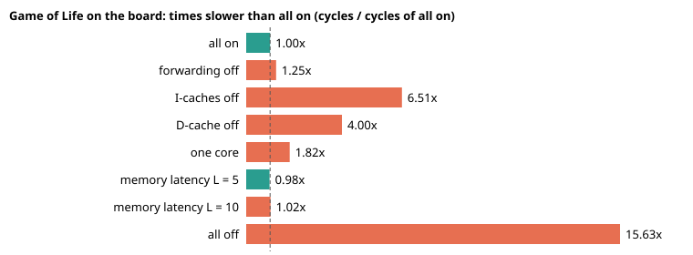
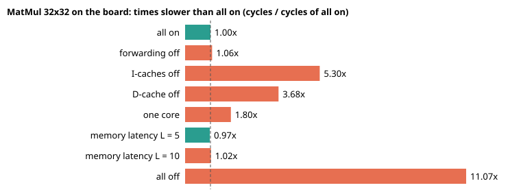

# Ablation on the board

Generated by `python scripts/ablation.py` from docs/results/ablation_board.csv (scripts/board_regress.py with scripts/ablation_list.txt; board measurements, every run golden and equal to rv32sim's packets). Factor = cycles / cycles of "all on" (above 1: slower without the feature). CPI = cycles / instructions of core 0; rates in % of core 0's accesses (core 1 where shown).

## Game of Life

| CSV row | Setting | CONFIG | Cores | Cycles | Time | Factor | CPI c0 | D-hit c0 | D-hit c1 | I-hit c0 | Arbiter wait c0 |
| --- | --- | --- | --- | --- | --- | --- | --- | --- | --- | --- | --- |
| gol_all_on | all on (2 cores, FWD, IC, DC, L = 8) | 0x0097 | 2 | 38,660,388 | 773.21 ms | 1.00x | 1.65 | 98.53 % | 98.56 % | 100.00 % | 8.98 % |
| gol_fwd_off | forwarding off | 0x0096 | 2 | 48,301,363 | 966.03 ms | 1.25x | 2.06 | 98.49 % | 98.56 % | 100.00 % | 7.25 % |
| gol_ic_off | I-caches off | 0x0017 | 2 | 251,696,594 | 5.034 s | 6.51x | 10.74 | 98.51 % | 98.56 % | - | 0.37 % |
| gol_dc_off | D-cache off | 0x0095 | 2 | 154,753,199 | 3.095 s | 4.00x | 6.60 | - | - | 100.00 % | 37.47 % |
| gol_dual_off | one core | 0x0093 | 1 | 70,337,750 | 1.407 s | 1.82x | 1.50 | 98.57 % | - | 100.00 % | 0.00 % |
| gol_L5 | memory latency L = 5 | 0x0087 | 2 | 37,740,874 | 754.82 ms | 0.98x | 1.61 | 98.53 % | 98.56 % | 100.00 % | 7.96 % |
| gol_L10 | memory latency L = 10 | 0x009F | 2 | 39,279,220 | 785.58 ms | 1.02x | 1.68 | 98.53 % | 98.56 % | 100.00 % | 9.64 % |
| gol_all_off | all off (1 core, no forwarding, no caches, L = 8) | 0x0010 | 1 | 604,166,137 | 12.083 s | 15.63x | 12.90 | - | - | - | 0.00 % |

Worth the most (largest factor without it): I-caches off 6.51x, D-cache off 4.00x, one core 1.82x, forwarding off 1.25x. All off is 15.6x slower than all on.

## MatMul 32x32

| CSV row | Setting | CONFIG | Cores | Cycles | Time | Factor | CPI c0 | D-hit c0 | D-hit c1 | I-hit c0 | Arbiter wait c0 |
| --- | --- | --- | --- | --- | --- | --- | --- | --- | --- | --- | --- |
| matmul_all_on | all on (2 cores, FWD, IC, DC, L = 8) | 0x00F7 | 2 | 297,020 | 5.94 ms | 1.00x | 2.20 | 99.26 % | 96.86 % | 99.99 % | 14.21 % |
| matmul_fwd_off | forwarding off | 0x00F6 | 2 | 315,604 | 6.31 ms | 1.06x | 2.34 | 99.26 % | 96.85 % | 99.99 % | 8.81 % |
| matmul_ic_off | I-caches off | 0x0077 | 2 | 1,574,591 | 31.49 ms | 5.30x | 11.68 | 99.26 % | 96.86 % | - | 1.28 % |
| matmul_dc_off | D-cache off | 0x00F5 | 2 | 1,092,935 | 21.86 ms | 3.68x | 8.11 | - | - | 99.99 % | 36.21 % |
| matmul_dual_off | one core | 0x00F3 | 1 | 535,596 | 10.71 ms | 1.80x | 1.99 | 97.54 % | - | 100.00 % | 0.00 % |
| matmul_L5 | memory latency L = 5 | 0x00E7 | 2 | 289,377 | 5.79 ms | 0.97x | 2.15 | 99.26 % | 96.86 % | 99.99 % | 12.35 % |
| matmul_L10 | memory latency L = 10 | 0x00FF | 2 | 302,116 | 6.04 ms | 1.02x | 2.24 | 99.26 % | 96.86 % | 99.99 % | 15.39 % |
| matmul_all_off | all off (1 core, no forwarding, no caches, L = 8) | 0x0070 | 1 | 3,286,873 | 65.74 ms | 11.07x | 12.19 | - | - | - | 0.00 % |

Worth the most (largest factor without it): I-caches off 5.30x, D-cache off 3.68x, one core 1.80x, forwarding off 1.06x. All off is 11.1x slower than all on.

